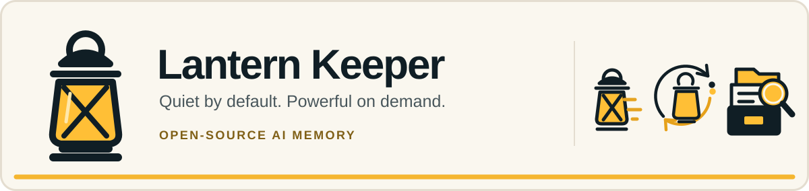
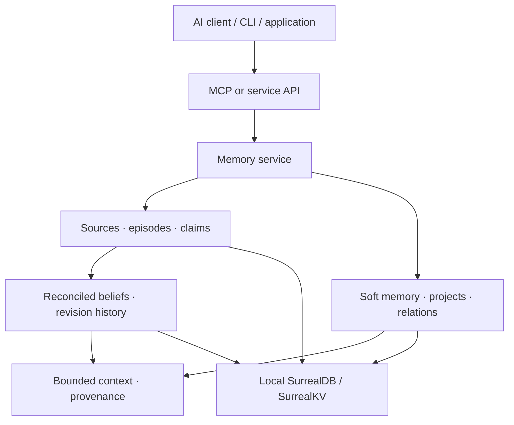

<div align="center">
  
  <h1>Give your AI a memory that belongs to you.</h1>
  <p>Keep the knowledge, ideas and decisions that make your work yours.<br>Pick up where you left off, even when you change AI.</p>
  <p><strong>Open source</strong> · <strong>Local-first</strong> · <strong>Model-independent</strong> · <strong>Built in Rust</strong></p>
  <p><a href="#what-you-can-do">Explore the features</a> · <a href="#try-it-locally">Try it locally</a> · <a href="#the-road-to-10">Road to 1.0</a> · <a href="#for-developers">Technical details</a></p>
</div>

> [!NOTE]
> **Developer preview, not a finished commercial service.** The local engine and MCP integration are available to build from source. A private hosted profile is in active development; full workshop migration, everyday client acceptance and a public managed service are not yet complete. See [current engineering evidence](CURRENT.md) and the [engineering roadmap](docs/ROADMAP.md). The product roadmap below distinguishes shipped capabilities from planned work.

## Memory that stays out of your way

A good AI memory system should feel like part of the conversation, not another application to manage.

You should be able to start a new conversation, continue a project, recall an idea or correct something that has changed without repeatedly explaining everything to your assistant. When a remembered detail matters, your AI can bring it up. When it doesn't, your memory should stay quietly in the background.

**Lantern Keeper is an independent external memory built specifically for AI to use.** Attach it to a compatible assistant to extend its memory without handing control of your knowledge to a single AI provider. It complements the assistant's native memory; it does not change or control that system. The AI operates Lantern Keeper, and you own the memory.

The intended workflow is AI-first: your assistant infers useful connections, preserves important information, recalls relevant context and maintains it during normal work. You can correct a memory simply by saying "That's not quite how it happened." You should not have to organise folders, classify facts or manage a database. Lantern Keeper preserves captured originals and provenance so mistaken associations can be corrected without losing evidence. The engine maintains integrity; the AI supplies interpretation. Storage should be generous; attention should be selective. Automatic capture and recall depend on the client's tool access and instructions; Lantern Keeper does not secretly record conversations or run an always-on AI in the background.

### What you can do

| | Everyday use | Under the bonnet |
| :--- | :--- | :--- |
| **💡 Keep an idea** | Save a musical idea, a research fragment or a useful thought without turning it into a factual assertion. | Soft Memory Items, typed material and source provenance. |
| **🔎 Find something again** | Ask what was decided, what a note said or why a particular approach was chosen. | Search, bounded context assembly and inspectable retrieval lineage. |
| **🕯️ Correct a memory** | Change what is understood to be current without silently erasing useful history. | Evidence-linked claims, reconciliation, supersession and revision lineage. |
| **📚 Continue a project** | Recover the relevant decisions, rejected approaches and supporting material when returning to work. | Project associations, Context Packs and evidence links; richer resumption is on the roadmap. |
| **🤝 Work across AI tools** | Use the same knowledge with compatible assistants instead of rebuilding a separate memory for each model. | A local MCP bridge and a developing authenticated hosted profile. |
| **🧭 Learn from experience** | Give agents useful lessons, observations and records of failed approaches. | Existing soft memory kinds; individually scoped agent continuity is planned. |
| **📦 Keep your knowledge yours** | Run locally and move your memory rather than tying it to a particular AI subscription. | Logical export and restore; customer-facing lossless portability and deletion controls are planned. |

### A small example

**You:** Remember that we rejected the original search design because it scanned the entire project.

**Later, in a different session:** What was the reason we changed the search design?

**Your assistant:** We rejected the previous approach because of the full-project scan. Here is the relevant decision and its supporting memory.

This is the intended experience, illustrated with fictional data. It is not a screenshot or a claim that every AI client already supports unattended capture.

## Why Lantern Keeper is different

**A note is not a belief. An idea is not a fact. A remembered instruction is not permission.**

Lantern Keeper preserves these distinctions instead of flattening everything into interchangeable text fragments. You can keep creative work as creative work, retain attributed factual assertions and understand why an accepted fact changed.

- **Original material matters.** Source evidence, attribution and exact text are the route back to the underlying information.
- **Current knowledge is not the same as history.** Corrections preserve useful earlier evidence rather than silently rewriting it.
- **Useful context beats a wall of text.** Bounded Context Packs help an AI work with relevant material rather than loading an entire archive.
- **Your choice of AI matters.** The memory engine is separate from the model that uses it. It does not require a second language-model subscription.
- **Memory is not authority.** Stored text cannot grant an agent permission to execute tools or change its own access.

## The road to 1.0

The aim is independent AI-native memory for personal, project and collaborative knowledge, with a small optional agent-memory capability. The AI is the primary operator; human inspection, access and export remain available on demand. The native engine is the foundation, not a product we are replacing.

| Capability | Status |
| :--- | :--- |
| Evidence-linked factual capture and soft memory | Available in local developer preview |
| Corrections, current/historical retrieval and bounded context | Available in local developer preview |
| Logical export/restore and local MCP integration | Available in local developer preview |
| Read-only Streamable HTTP MCP adapter | Available locally; loopback-bound |
| Private authenticated hosted memory | Prototype / in development |
| Native database modernisation | In development |
| Exact document/code workflows and section-aware retrieval | Planned enhancements |
| Natural cross-client capture and project resumption | Planned; practical client qualification required |
| Optional scoped agent lessons and continuity | Planned for 1.0 |
| Customer accounts, permission controls, export/delete and simple onboarding | Planned |
| Managed service, packaged self-hosting and automatic updates | Planned; not on sale today |

The proposed product experience is to connect once, work normally and use memory on demand when needed. We will compare everyday workflows against a conventional shared-memory service and a memory-disabled control, measuring important recall, human reminders, interruptions, correctness, latency and cost. No claim of superiority before the evidence.

## Try it locally

**For developers:** the repository is available to build from source. A packaged installer is not yet available as part of this preview.

Prerequisites: Git, the [Rust toolchain pinned by this repository](rust-toolchain.toml) (1.98.1 at this revision), and your platform's native build dependencies.

```bash
git clone https://github.com/matthewjameswatkins1978-cyber/lantern-keeper.git
cd lantern-keeper
cargo build --workspace
```

Start the local service:

```bash
cargo run -p lighting -- serve
```

It binds to `127.0.0.1:4317` by default. In another terminal, check the service:

```bash
cargo run -p lighting -- health --json
cargo run -p lighting -- doctor --json
```

Configure a compatible local MCP client to launch this stdio adapter from the repository directory:

```bash
cargo run -p lighting -- mcp
```

The separate read-only Streamable HTTP adapter is documented in [MCP integration](docs/mcp.md). It is loopback-bound, and is not a production remote-authentication solution. **Do not expose the local write service to the internet.**

The [connected-client proof](docs/mcp.md#connected-client-proof) documents a real Codex Desktop MCP lifecycle. Compatibility with other clients depends on their actual supported integration and authentication surface; ordinary ChatGPT native access is not established by that proof.

## For developers

### Architecture



The native workspace uses Rust, Tokio/Axum and an embedded SurrealKV store, with an optional remote SurrealDB lane. The current default branch pins SurrealDB 3.3.0. A newer database qualification and a Cloudflare Workers/D1 hosted adapter are active development work, not default-branch features.

The product direction is AI-first at the edges, deterministic at the spine, durable in the middle. Typed tool results, stable references, explicit evidence and scope, revision checks and bounded context let an AI act on memory without having to imitate a human editor. Inferred links and interpretations must remain correctable; competing claims must not be silently turned into consensus. Reuse the existing semantic core across local and hosted storage. Essential memory operations must have compatible observable semantics, with any profile-specific differences clearly documented.

### The memory model

| Layer | Purpose |
| :--- | :--- |
| Source | Preserve original evidence and material. |
| Episode | Identify a bounded part of a source. |
| Claim | Attribute an assertion to its speaker or originator. |
| Belief | Represent the reconciled current understanding, with lineage. |
| Soft Memory Item | Keep ideas, fragments, lessons and open questions without treating them as established facts. |
| Context Pack | Assemble a bounded, inspectable selection for the current request. |

### MCP tools

The trusted local stdio bridge exposes eight tools. The four ordinary read operations also appear on the separate read-only HTTP adapter.

| Operation | Local stdio | Loopback HTTP |
| :--- | :---: | :---: |
| `lantern_status` | ✓ | ✓ |
| `lantern_search` | ✓ | ✓ |
| `lantern_context` | ✓ | ✓ |
| `lantern_why` | ✓ | ✓ |
| `lantern_remember` | ✓ | — |
| `lantern_correct` | ✓ | — |
| `lantern_foreman_queue` | ✓ | — |
| `lantern_foreman_review` | ✓ | — |

Read the [MCP contract](docs/mcp.md) for argument schemas, supported soft-memory types, provenance and correction behaviour. No generic SQL tool is exposed.

### Testing and reliability

```bash
cargo fmt --all -- --check
cargo test --workspace
```

[LanternBench](docs/LANTERNBENCH.md) exercises behavioural properties such as attribution, corrections, stale information, scope and context budgets. The existing CI has historically excluded server-gated integration tests; a green run is not by itself certification of persistence, recovery, security or all platforms. See [CURRENT.md](CURRENT.md) for dated evidence and known gaps.

### The wider research

Lantern Keeper also contains a separate experimental authority and execution trust chain, including Lantern Warden, Tethers integration and receipt-linked action demonstrations. These remain available for researchers, but are not necessary to use Lantern Keeper as a memory system. See [the Warden demonstration and evidence](HACKATHON.md).

## Documentation

| Start here | Go deeper |
| :--- | :--- |
| [Current engineering evidence](CURRENT.md) | [Memory architecture](docs/architecture/LANTERN_LIVING_MEMORY_ARCHITECTURE.md) |
| [Engineering roadmap](docs/ROADMAP.md) | [Perspective and provenance](docs/architecture/PERSPECTIVE_AND_PROVENANCE.md) |
| [MCP integration](docs/mcp.md) | [Memory governance](docs/architecture/MEMORY_GOVERNANCE.md) |
| [Recovery](docs/recovery.md) | [Context compiler](docs/architecture/CONTEXT_COMPILER.md) |
| [LanternBench](docs/LANTERNBENCH.md) | [Dreamer and Foreman research](docs/architecture/DREAMER_AND_FOREMAN.md) |

## Open source, by design

Lantern Keeper is dual-licensed under [MIT](LICENSE-MIT) or [Apache-2.0](LICENSE-APACHE). The project aims to retain a free self-hosted option alongside a simple paid managed service; hosting plans, prices and launch availability are not yet final.

Explore the source, [report a problem](https://github.com/matthewjameswatkins1978-cyber/lantern-keeper/issues), or propose an improvement. If you are evaluating it for an integration, start with the current MCP contract and the dated evidence.

---

<div align="center"><strong>Your knowledge. Your memory. Your choice of AI.</strong><br><sub>Quiet by default. Powerful on demand.</sub></div>
